# PGR Wallpaper Archive

Automated repository to archive high-quality wallpapers from Punishing: Gray Raven.

     

> **Last Archive Update:** 2026-11-13T06:04:36Z

[Browse & Filter Wallpapers on Web](https://pgr-wallpapers.tungvuthanh.com/)

## 📥 Download All Wallpapers

| What you get | Files | Size | Download |
|---|---|---|---|
| `desktop/` only | 3035 | 21.90 GB | [⬇ desktop.zip](https://github.com/SilverKnightKMA/pgr-wallpaper-archive/archive/refs/heads/desktop.zip) |
| `mobile/` only | 102 | 197.39 MB | [⬇ mobile.zip](https://github.com/SilverKnightKMA/pgr-wallpaper-archive/archive/refs/heads/mobile.zip) |
| everything (desktop + mobile) | 3137 | 22.10 GB | [⬇ wallpapers.zip](https://github.com/SilverKnightKMA/pgr-wallpaper-archive/archive/refs/heads/wallpapers.zip) |

Incremental updates are also published as [Releases](https://github.com/SilverKnightKMA/pgr-wallpaper-archive/releases).

## 🎲 Random Wallpaper API

A tiny [Cloudflare Worker](https://github.com/SilverKnightKMA/pgr-wallpaper-archive/blob/main/worker/worker.js) serves a random wallpaper as real image bytes:

| Endpoint | Returns |
|---|---|
| [`/wallpapers`](https://pgr-wallpapers.tungvuthanh.com/wallpapers) | random image, any category |
| [`/desktop`](https://pgr-wallpapers.tungvuthanh.com/desktop) | random **desktop** wallpaper |
| [`/mobile`](https://pgr-wallpapers.tungvuthanh.com/mobile) | random **mobile** wallpaper |

Full API reference — query params, responses, and errors — lives in the [worker README](https://github.com/SilverKnightKMA/pgr-wallpaper-archive/blob/main/worker/README.md#query-params).

## Server Galleries

| Server | Total | Desktop | Mobile | Success | Failed | Last Updated |
|--------|-------|---------|--------|---------|--------|--------------|
| [CN Server](https://github.com/SilverKnightKMA/pgr-wallpaper-archive/tree/preview/cn) | 986 | 912 | 74 | 986 | 0 | 2026-09-30T09:52:17Z |
| [JP Server](https://github.com/SilverKnightKMA/pgr-wallpaper-archive/tree/preview/jp) | 776 | 769 | 7 | 776 | 0 | 2026-11-12T07:58:11Z |
| [Global Server](https://github.com/SilverKnightKMA/pgr-wallpaper-archive/tree/preview/global) | 444 | 427 | 17 | 444 | 0 | 2026-11-10T08:22:12Z |
| [TW Server](https://github.com/SilverKnightKMA/pgr-wallpaper-archive/tree/preview/tw) | 287 | 284 | 3 | 287 | 0 | 2026-11-11T04:00:00Z |
| [KR Server](https://github.com/SilverKnightKMA/pgr-wallpaper-archive/tree/preview/kr) | 631 | 630 | 1 | 631 | 0 | 2026-11-11T10:36:33Z |
| [Recovered (pre-2026)](https://github.com/SilverKnightKMA/pgr-wallpaper-archive/tree/preview/recovered) | 13 | 13 | 0 | 13 | 0 | 2026-11-13T06:04:36Z |

---

## Wallpaper Preview

### CN Server

<table>
  <tr>
    <td width="20%" align="center" valign="middle">
      
    </td>
    <td width="20%" align="center" valign="middle">
      
    </td>
    <td width="20%" align="center" valign="middle">
      
    </td>
    <td width="20%" align="center" valign="middle">
      <a href="https://github.com/SilverKnightKMA/pgr-wallpaper-archive/raw/wallpapers/desktop/8f97xz7u6muu3csnon-179076183124101.png">
        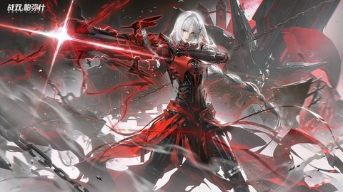
      </a>
    </td>
    <td width="20%" align="center" valign="middle">
      
    </td>
  </tr>
  <tr>
    <td width="20%" align="center" valign="middle">
      
    </td>
    <td width="20%" align="center" valign="middle">
      <a href="https://github.com/SilverKnightKMA/pgr-wallpaper-archive/raw/wallpapers/desktop/f0mc9ajbgoiuyo77dq-179076178418504.png">
        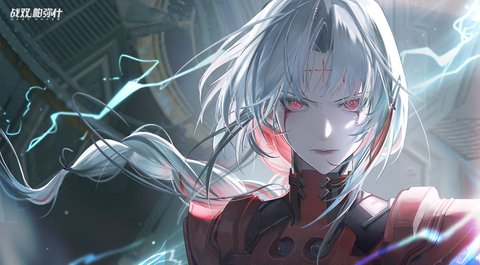
      </a>
    </td>
    <td width="20%" align="center" valign="middle">
      <a href="https://github.com/SilverKnightKMA/pgr-wallpaper-archive/raw/wallpapers/desktop/7812bsxaqolb8zi6lj-179076177044805.png">
        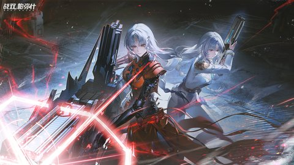
      </a>
    </td>
    <td width="20%" align="center" valign="middle">
      <a href="https://github.com/SilverKnightKMA/pgr-wallpaper-archive/raw/wallpapers/desktop/l067ljtjdamy5l8uso-179076173101106.png">
        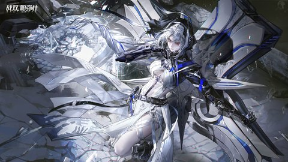
      </a>
    </td>
    <td width="20%" align="center" valign="middle">
      <a href="https://github.com/SilverKnightKMA/pgr-wallpaper-archive/raw/wallpapers/desktop/8j7vmj8qlg0wfj2ovr-179076171436807.png">
        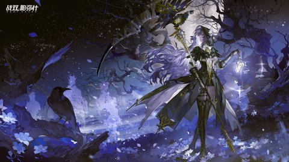
      </a>
    </td>
  </tr>
  <tr>
    <td width="20%" align="center" valign="middle">
      
    </td>
    <td width="20%" align="center" valign="middle">
      <a href="https://github.com/SilverKnightKMA/pgr-wallpaper-archive/raw/wallpapers/desktop/y9b8ahsp9ndbwhardw-179076168731209.png">
        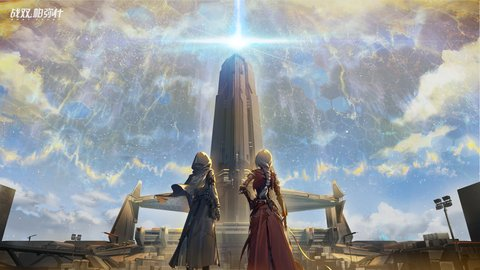
      </a>
    </td>
    <td width="20%" align="center" valign="middle">
      
    </td>
    <td width="20%" align="center" valign="middle">
      
    </td>
    <td width="20%" align="center" valign="middle">
      
    </td>
  </tr>
</table>

### JP Server

<table>
  <tr>
    <td width="20%" align="center" valign="middle">
      <a href="https://github.com/SilverKnightKMA/pgr-wallpaper-archive/raw/wallpapers/desktop/y2g7eod8k0d28y48mp-179447029799709.jpg">
        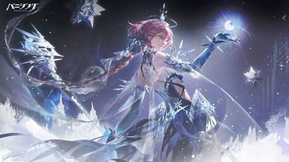
      </a>
    </td>
    <td width="20%" align="center" valign="middle">
      
    </td>
    <td width="20%" align="center" valign="middle">
      <a href="https://github.com/SilverKnightKMA/pgr-wallpaper-archive/raw/wallpapers/desktop/a8824g11bojncba81r-179447023510307.jpg">
        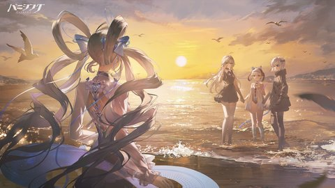
      </a>
    </td>
    <td width="20%" align="center" valign="middle">
      <a href="https://github.com/SilverKnightKMA/pgr-wallpaper-archive/raw/wallpapers/desktop/2dnu4bwlclfa61p5ub-179447021872806.jpg">
        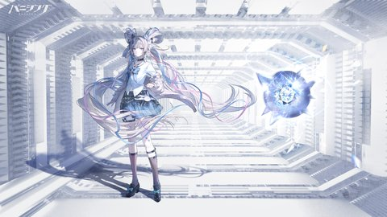
      </a>
    </td>
    <td width="20%" align="center" valign="middle">
      <a href="https://github.com/SilverKnightKMA/pgr-wallpaper-archive/raw/wallpapers/desktop/t590kzblv67mw4poc5-179447020074905.jpg">
        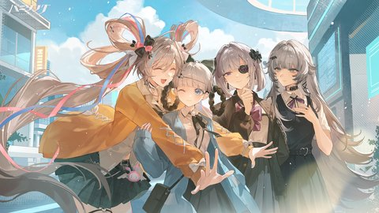
      </a>
    </td>
  </tr>
  <tr>
    <td width="20%" align="center" valign="middle">
      <a href="https://github.com/SilverKnightKMA/pgr-wallpaper-archive/raw/wallpapers/desktop/j1c07t9d3127i3zwfn-179447017541904.jpg">
        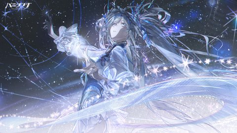
      </a>
    </td>
    <td width="20%" align="center" valign="middle">
      
    </td>
    <td width="20%" align="center" valign="middle">
      <a href="https://github.com/SilverKnightKMA/pgr-wallpaper-archive/raw/wallpapers/desktop/sov4jmf34lwiqc7v2n-179447012974202.jpg">
        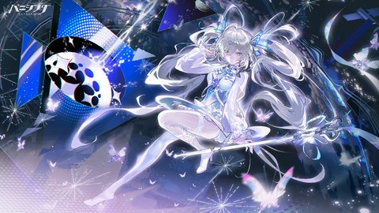
      </a>
    </td>
    <td width="20%" align="center" valign="middle">
      
    </td>
    <td width="20%" align="center" valign="middle">
      
    </td>
  </tr>
  <tr>
    <td width="20%" align="center" valign="middle">
      
    </td>
    <td width="20%" align="center" valign="middle">
      
    </td>
    <td width="20%" align="center" valign="middle">
      
    </td>
    <td width="20%" align="center" valign="middle">
      <a href="https://github.com/SilverKnightKMA/pgr-wallpaper-archive/raw/wallpapers/desktop/szijkim0fmlkimqbzb-17905892832435.jpg">
        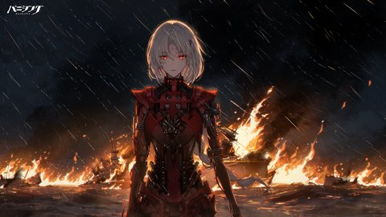
      </a>
    </td>
    <td width="20%" align="center" valign="middle">
      
    </td>
  </tr>
</table>

### Global Server

<table>
  <tr>
    <td width="20%" align="center" valign="middle">
      
    </td>
    <td width="20%" align="center" valign="middle">
      
    </td>
    <td width="20%" align="center" valign="middle">
      
    </td>
    <td width="20%" align="center" valign="middle">
      
    </td>
    <td width="20%" align="center" valign="middle">
      
    </td>
  </tr>
  <tr>
    <td width="20%" align="center" valign="middle">
      
    </td>
    <td width="20%" align="center" valign="middle">
      <a href="https://github.com/SilverKnightKMA/pgr-wallpaper-archive/raw/wallpapers/desktop/jgkm98wy906ugq7xdf-179429881791803.jpg">
        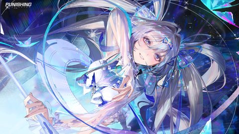
      </a>
    </td>
    <td width="20%" align="center" valign="middle">
      
    </td>
    <td width="20%" align="center" valign="middle">
      
    </td>
    <td width="20%" align="center" valign="middle">
      <a href="https://github.com/SilverKnightKMA/pgr-wallpaper-archive/raw/wallpapers/desktop/gn2h1kip51pnb0j8fp-17907592900853.%E8%81%94%E5%8A%A8%E7%9A%AE%E8%82%A4%E6%B5%B7%E6%8A%A5.png">
        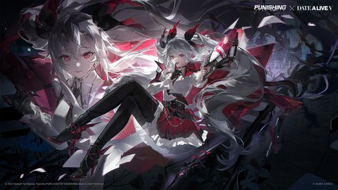
      </a>
    </td>
  </tr>
  <tr>
    <td width="20%" align="center" valign="middle">
      <a href="https://github.com/SilverKnightKMA/pgr-wallpaper-archive/raw/wallpapers/desktop/u3s4g09ok15ui3g3un-17907592726942.%E8%81%94%E5%8A%A8cg.png">
        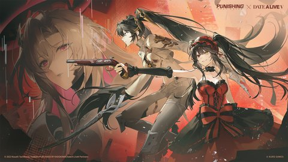
      </a>
    </td>
    <td width="20%" align="center" valign="middle">
      <a href="https://github.com/SilverKnightKMA/pgr-wallpaper-archive/raw/wallpapers/desktop/r4tbh04qj887va1d91-17907592552701.%E8%81%94%E5%8A%A8kv.png">
        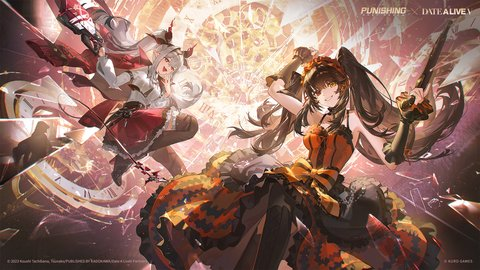
      </a>
    </td>
    <td width="20%" align="center" valign="middle">
      <a href="https://github.com/SilverKnightKMA/pgr-wallpaper-archive/raw/wallpapers/desktop/3yp0x8vancbllw7ca2-179075923067109.png">
        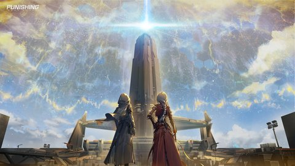
      </a>
    </td>
    <td width="20%" align="center" valign="middle">
      
    </td>
    <td width="20%" align="center" valign="middle">
      <a href="https://github.com/SilverKnightKMA/pgr-wallpaper-archive/raw/wallpapers/desktop/isgp1zeofrp0qn2asm-179075919554907.png">
        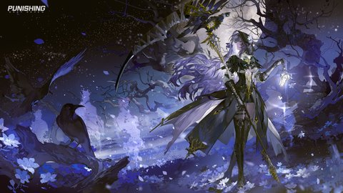
      </a>
    </td>
  </tr>
</table>

### TW Server

<table>
  <tr>
    <td width="20%" align="center" valign="middle">
      
    </td>
    <td width="20%" align="center" valign="middle">
      <a href="https://github.com/SilverKnightKMA/pgr-wallpaper-archive/raw/wallpapers/desktop/92t9qr57bnevmgcyz6-179430192415704.jpg">
        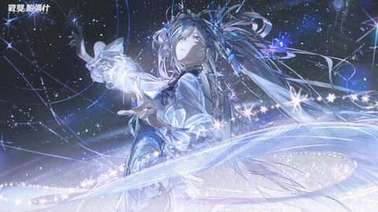
      </a>
    </td>
    <td width="20%" align="center" valign="middle">
      
    </td>
    <td width="20%" align="center" valign="middle">
      
    </td>
    <td width="20%" align="center" valign="middle">
      <a href="https://github.com/SilverKnightKMA/pgr-wallpaper-archive/raw/wallpapers/desktop/fkv4nl3x5ljt6g90wv-179430203107301.jpg">
        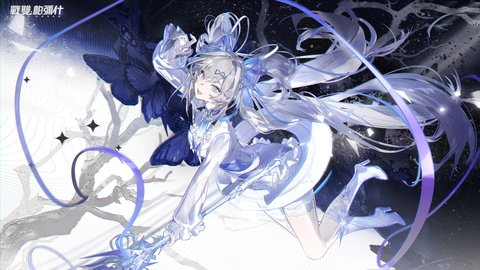
      </a>
    </td>
  </tr>
  <tr>
    <td width="20%" align="center" valign="middle">
      
    </td>
    <td width="20%" align="center" valign="middle">
      
    </td>
    <td width="20%" align="center" valign="middle">
      
    </td>
    <td width="20%" align="center" valign="middle">
      
    </td>
    <td width="20%" align="center" valign="middle">
      
    </td>
  </tr>
  <tr>
    <td width="20%" align="center" valign="middle">
      
    </td>
    <td width="20%" align="center" valign="middle">
      <a href="https://github.com/SilverKnightKMA/pgr-wallpaper-archive/raw/wallpapers/desktop/09788f7ulou7xqbzu9-17905944012833.%E8%81%94%E5%8A%A8%E7%9A%AE%E8%82%A4%E6%B5%B7%E6%8A%A5.png">
        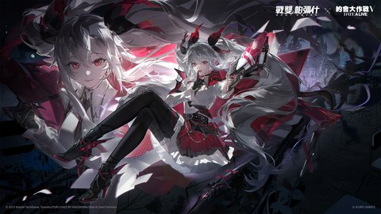
      </a>
    </td>
    <td width="20%" align="center" valign="middle">
      
    </td>
    <td width="20%" align="center" valign="middle">
      <a href="https://github.com/SilverKnightKMA/pgr-wallpaper-archive/raw/wallpapers/desktop/je745ijy5wmwahipsf-179059412517502.png">
        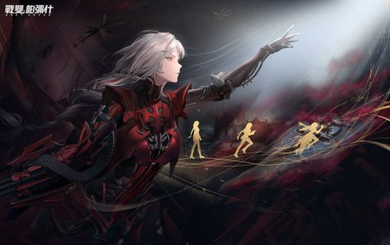
      </a>
    </td>
    <td width="20%" align="center" valign="middle">
      
    </td>
  </tr>
</table>

### KR Server

<table>
  <tr>
    <td width="20%" align="center" valign="middle">
      <a href="https://github.com/SilverKnightKMA/pgr-wallpaper-archive/raw/wallpapers/desktop/ufvmrckc40cmka6uf0-179439339950409.jpg">
        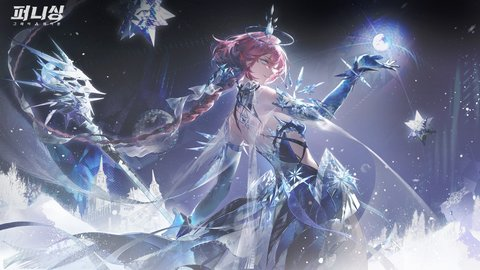
      </a>
    </td>
    <td width="20%" align="center" valign="middle">
      <a href="https://github.com/SilverKnightKMA/pgr-wallpaper-archive/raw/wallpapers/desktop/zv9rghb2orc64709sg-179439338468008.png">
        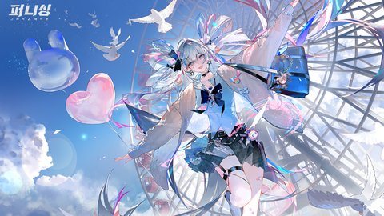
      </a>
    </td>
    <td width="20%" align="center" valign="middle">
      
    </td>
    <td width="20%" align="center" valign="middle">
      <a href="https://github.com/SilverKnightKMA/pgr-wallpaper-archive/raw/wallpapers/desktop/1so2feohbce59y1s9j-179439335158906.jpg">
        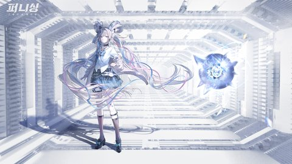
      </a>
    </td>
    <td width="20%" align="center" valign="middle">
      
    </td>
  </tr>
  <tr>
    <td width="20%" align="center" valign="middle">
      
    </td>
    <td width="20%" align="center" valign="middle">
      
    </td>
    <td width="20%" align="center" valign="middle">
      <a href="https://github.com/SilverKnightKMA/pgr-wallpaper-archive/raw/wallpapers/desktop/lb95i7qyv6c0l7c3ht-179439328950802.jpg">
        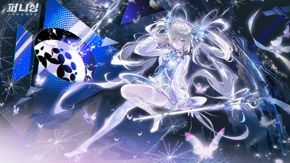
      </a>
    </td>
    <td width="20%" align="center" valign="middle">
      
    </td>
    <td width="20%" align="center" valign="middle">
      <a href="https://github.com/SilverKnightKMA/pgr-wallpaper-archive/raw/wallpapers/desktop/g6y7iiburii3xn2mba-17943925075993.%E8%81%94%E5%8A%A8%E7%9A%AE%E8%82%A4%E6%B5%B7%E6%8A%A5.jpg">
        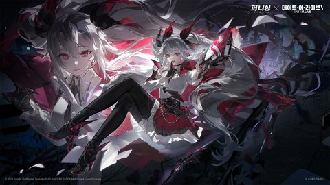
      </a>
    </td>
  </tr>
  <tr>
    <td width="20%" align="center" valign="middle">
      
    </td>
    <td width="20%" align="center" valign="middle">
      <a href="https://github.com/SilverKnightKMA/pgr-wallpaper-archive/raw/wallpapers/desktop/zqd0z8q6puwswk5n4s-17943924733781.%E8%81%94%E5%8A%A8kv.jpg">
        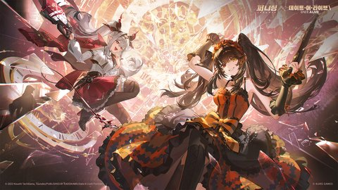
      </a>
    </td>
    <td width="20%" align="center" valign="middle">
      
    </td>
    <td width="20%" align="center" valign="middle">
      
    </td>
    <td width="20%" align="center" valign="middle">
      <a href="https://github.com/SilverKnightKMA/pgr-wallpaper-archive/raw/wallpapers/desktop/mu7lb6dppsh4v1mu6v-179439241051807.png">
        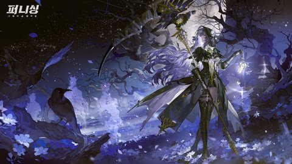
      </a>
    </td>
  </tr>
</table>

### Recovered (pre-2026)

<table>
  <tr>
    <td width="20%" align="center" valign="middle">
      <a href="https://github.com/SilverKnightKMA/pgr-wallpaper-archive/raw/wallpapers/desktop/26b042e41312f9c9d22df8d6df669b0c382651856.png">
        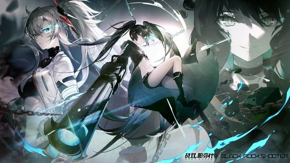
      </a>
    </td>
    <td width="20%" align="center" valign="middle">
      <a href="https://github.com/SilverKnightKMA/pgr-wallpaper-archive/raw/wallpapers/desktop/3ismmz1s8nvhv8j57qraa06en6xj29ke.png">
        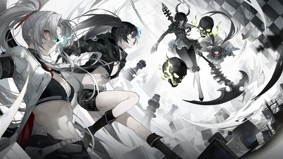
      </a>
    </td>
    <td width="20%" align="center" valign="middle">
      <a href="https://github.com/SilverKnightKMA/pgr-wallpaper-archive/raw/wallpapers/desktop/40ps5ldygf0ho1nj0r54f2ag7p3jxthe.png">
        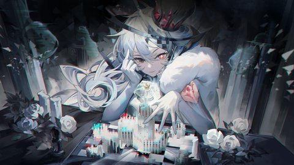
      </a>
    </td>
    <td width="20%" align="center" valign="middle">
      
    </td>
    <td width="20%" align="center" valign="middle">
      <a href="https://github.com/SilverKnightKMA/pgr-wallpaper-archive/raw/wallpapers/desktop/7jq3kgv8035lwkdrzse6pah56dkqx4vb.png">
        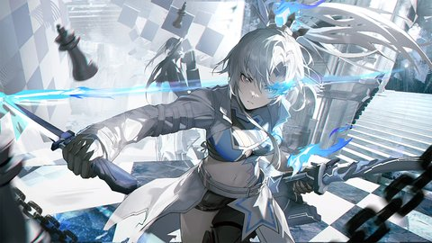
      </a>
    </td>
  </tr>
  <tr>
    <td width="20%" align="center" valign="middle">
      
    </td>
    <td width="20%" align="center" valign="middle">
      
    </td>
    <td width="20%" align="center" valign="middle">
      
    </td>
    <td width="20%" align="center" valign="middle">
      
    </td>
    <td width="20%" align="center" valign="middle">
      <a href="https://github.com/SilverKnightKMA/pgr-wallpaper-archive/raw/wallpapers/desktop/mjul1fq825bvt871l6tup9so2rxe8uk0.png">
        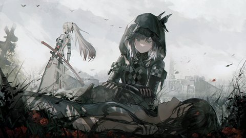
      </a>
    </td>
  </tr>
  <tr>
    <td width="20%" align="center" valign="middle">
      
    </td>
    <td width="20%" align="center" valign="middle">
      <a href="https://github.com/SilverKnightKMA/pgr-wallpaper-archive/raw/wallpapers/desktop/qdgc9oyai985jw93bz126ncm8rcaxjy8.png">
        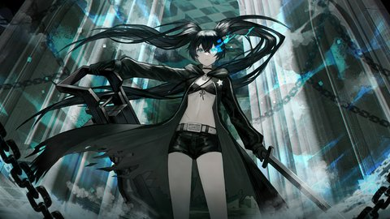
      </a>
    </td>
    <td width="20%" align="center" valign="middle">
      
    </td>
  </tr>
</table>
